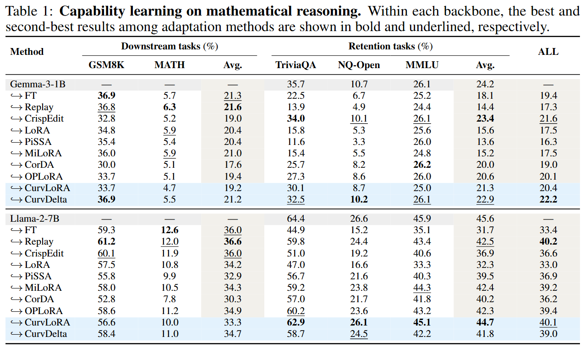
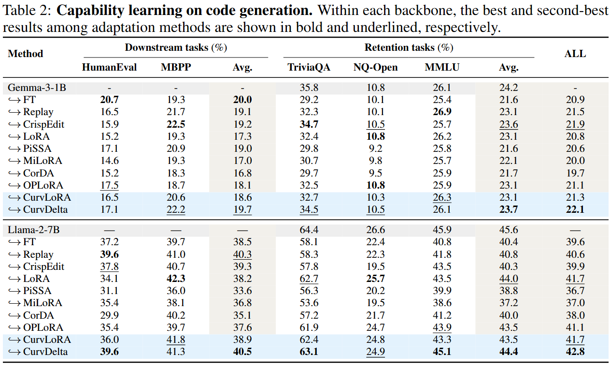

# CurvDelta: Low-Curvature Delta Modeling For Surgical Learning and Unlearning

This repository contains the capability-learning implementation of CurvDelta and CurvLoRA, based on [yuang-lee/lr-matters-lora](https://github.com/yuang-lee/lr-matters-lora).

## Abstract

A central challenge in adapting large language models (LLMs) is capability preservation: an adaptation can achieve its target while degrading general capabilities. We introduce CurvDelta, a scalable framework that incorporates the preservation constraint into the parameterization of the model update. By analyzing the local geometry of the preservation constraint around the pre-adaptation model, CurvDelta constructs a low-curvature space in which parameter updates leave the preservation loss nearly invariant. We make its construction practical for LLMs through Kronecker-factored approximate curvature (K-FAC) and a factorized projection. We also introduce CurvLoRA, a low-rank variant within the same preservation geometry, designed for more efficient adaptation. Both methods apply to preservation-constrained adaptation tasks such as capability learning and selective unlearning. We evaluate our methods on mathematical reasoning, code generation, and knowledge unlearning. For mathematical reasoning and code generation, our approaches achieve competitive downstream performance while better preserving general capabilities, offering a favorable acquisition--retention trade-off relative to the baselines. For knowledge unlearning, our main results on TOFU and MUSE show a better balance between targeted forgetting and knowledge retention than the baselines, with retention performance close to the from-scratch retraining reference.


**Overview.** CurvDelta constructs a low-curvature update space that preserves general capabilities during adaptation. CurvLoRA is its low-rank variant.

## Main Results

### Mathematical reasoning



### Code generation



Baselines include FT, LoRA, [Replay](https://proceedings.neurips.cc/paper/2019/hash/fa7cdfad1a5aaf8370ebeda47a1ff1c3-Abstract.html), [CorDA](https://proceedings.neurips.cc/paper_files/paper/2024/hash/83f95bb0ac5046338ea2afe3390e9f4b-Abstract-Conference.html), [PiSSA](https://proceedings.neurips.cc/paper_files/paper/2024/hash/db36f4d603cc9e3a2a5e10b93e6428f2-Abstract-Conference.html), [MiLoRA](https://aclanthology.org/2026.acl-long.890/), [OPLoRA](https://ojs.aaai.org/index.php/AAAI/article/view/40703), and [CrispEdit](https://icml.cc/virtual/2026/poster/62453).

## Quick Start

Create the environment from the original implementation requirements, then install the capability-learning dependencies:

```bash
cd run-lora
conda create -n curvdelta-learning python=3.12 -y
conda activate curvdelta-learning
pip install -r requirements.txt
```

Set local storage and optional service credentials through environment variables. Do not store credentials in this repository.

```bash
export PROJECT_DATA_ROOT=/path/to/project-data
export GPU_IDS=0,1,2,3
export HF_TOKEN=your_huggingface_token
export WANDB_API_KEY=your_wandb_api_key
```

Download the Gemma-3-1B and Llama-2-7B backbones:

```bash
cd ..
bash common_utils/download_cli.sh
```

Prepare MetaMath, Python/code-generation, and preservation data:

```bash
cd run-lora
bash scripts/download_datasets.sh
python utils/save_finefineweb.py
```

The preservation set contains 256 examples sampled from FineFineWeb validation. Representative launchers keep the original model/task layout and call `scripts/run_best_common.sh`. Each method-specific launcher contains its learning-rate sweep:

```bash
bash scripts/gemma/math_curvlora.sh
bash scripts/gemma/code_crispedit.sh
bash scripts/llama/math_oplora.sh
bash scripts/llama/code_replay.sh
```

## License

See [LICENSE](LICENSE).
